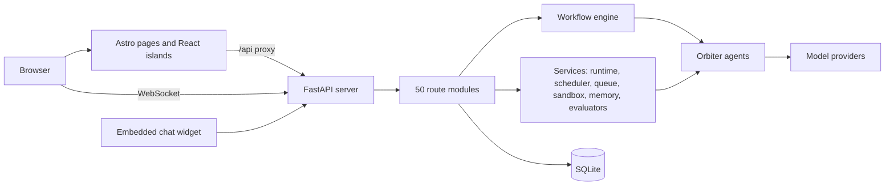

# orbiter-web

The web platform for Orbiter, Midsphere's agent framework, which is now called [Exo](https://github.com/midsphere-ai/exo). You build agents, wire them into workflows on a visual canvas, test them in a playground, deploy them behind an API or a chat widget, and watch runs, costs and logs, all from the browser.

It is one Astro frontend and one FastAPI server sharing a SQLite database.

## What it does

- Agents: create, edit and version agents, start from templates, group them into crews, add a supervisor agent.
- Workflows: a React Flow canvas with nodes for LLM calls, agents, code, conditionals, HTTP requests, knowledge retrieval, approval gates, notifications and webhook triggers. The engine runs nodes in topological order with retries, cancellation and a step-through debug mode.
- Playground: streamed chat with an agent over WebSocket, with threads, checkpoints and context inspection.
- Knowledge: document upload, processing and vector stores for retrieval.
- Tools: custom tools with a schema editor, MCP servers, plugins and a code sandbox.
- Deployments: publish an agent as an API endpoint or as an embeddable chat widget (`public/widget.js`).
- Monitoring: runs, logs, metrics, costs, alerts, audit log and exports to external observability tools.
- Quality: evaluations, benchmarks, annotations, safety checks and prompt optimisation.
- Operations: schedules, a run queue, webhooks, CI endpoints with API keys, workspace export, data retention.
- Accounts: email and password login with bcrypt, sessions, roles (admin, developer, viewer), CSRF protection, rate limits and encrypted provider keys.

In numbers: 319 API routes across 50 route modules, 8 of them WebSocket. 69 SQL migrations. 49 pages. About 26,700 lines of Python, 35,400 of Astro and 13,300 of TypeScript.

## How it works



## Layout

| Path | What is in it |
|---|---|
| `src/pages/` | Astro pages, one per screen |
| `src/islands/Canvas/` | Workflow canvas and node config panels (React) |
| `src/islands/AgentGraph/`, `src/islands/PlanPanel/` | Agent graph and plan views |
| `src/components/`, `src/layouts/` | Shared UI |
| `src/content/docs/` | In-app documentation |
| `src/orbiter_web/app.py` | FastAPI app and middleware |
| `src/orbiter_web/routes/` | HTTP and WebSocket API |
| `src/orbiter_web/engine.py` | Workflow execution engine |
| `src/orbiter_web/services/` | Agent runtime, scheduler, run queue, sandbox, memory, evaluators, safety |
| `src/orbiter_web/migrations/` | SQL migrations, applied on startup |
| `src/orbiter_web/cli.py` | `create-user` and `migrate` commands |
| `public/widget.js` | Embeddable chat widget |

## Setup

You need Python 3.11 or newer, [uv](https://docs.astral.sh/uv/) and Node 20 or newer. This was a package inside the Orbiter monorepo at `packages/orbiter-web`, and `pyproject.toml` resolves `orbiter-core` and `orbiter-models` from that workspace.

```bash
npm install
uv run python -m orbiter_web.cli create-user --email admin@example.com --password <password> --admin
npm run dev
```

`npm run dev` starts Astro on port 4321 and the API on port 8000. The database is created and migrated on first start.

## Environment variables

| Variable | Default | Purpose |
|---|---|---|
| `ORBITER_DATABASE_URL` | `sqlite+aiosqlite:///orbiter.db` | Database location |
| `ORBITER_SECRET_KEY` | `change-me-in-production` | Encrypts stored provider keys. Set your own. |
| `ORBITER_DEBUG` | `false` | Debug mode |
| `ORBITER_SESSION_EXPIRY_HOURS` | `72` | Login session lifetime |
| `ORBITER_RATE_LIMIT_AUTH` | `5` | Auth requests per minute |
| `ORBITER_RATE_LIMIT_GENERAL` | `200` | General requests per minute |
| `ORBITER_RATE_LIMIT_AGENT` | `10` | Agent run requests per minute |
| `ORBITER_MAX_UPLOAD_MB` | `50` | Upload size limit |
| `ORBITER_UPLOAD_DIR` | `data/uploads/` | Uploaded files |
| `ORBITER_ARTIFACT_DIR` | `data/artifacts/` | Run artifacts |
| `ORBITER_CLEANUP_INTERVAL_HOURS` | `6` | Background cleanup interval |
| `ORBITER_CORS_ORIGINS` | empty | Comma-separated allowed origins |

Model provider keys are added in Settings and stored encrypted.

## Status

Midsphere AI wound down in 2026. This is published as it was and is not maintained.

## Licence

[MIT](LICENSE). Free to use, change, self-host and build on, including commercially. The Junicode font in `public/fonts` is under the SIL Open Font License.

Thanks to Astro, FastAPI, React Flow, Tailwind CSS and Junicode.
